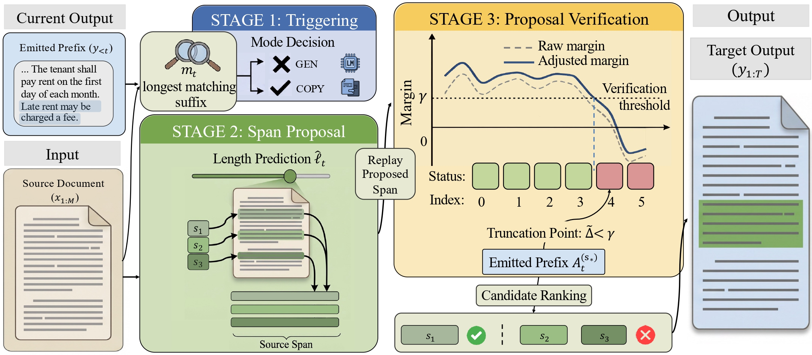

# CopyGen

<p align="center">
  <a href="https://neurips.cc">
    
  </a>
  <a href="https://arxiv.org/pdf/">
    
  </a>
  <a href="LICENSE">
    
  </a>
</p>

----

Official repository for the paper:

**When Copying Is Hard: Copy-Constrained Decoding for Exact Span Reproduction**



CopyGen is a lightweight copy-constrained decoding plugin for frozen language models. It treats exact span reproduction as a controlled decoding problem: the plugin decides when to copy from the source context, proposes a tentative copy span, and verifies the span token by token before emitting it.

## Repository Layout

```text
data/      Released benchmark data
model/     CopyGen training and decoding implementation
scripts/   Data construction, baselines, and analysis utilities
```

Generated outputs and checkpoints are intentionally ignored by git. By default, new experiment artifacts should be written under `outputs/`.

## Benchmark Data

The released benchmark is organized by domain:


| Domain          | Task                           | Directory               |
| --------------- | ------------------------------ | ----------------------- |
| Contract        | Legal Clause Extraction        | `data/contract/`        |
| Literature      | Scientific Evidence Extraction | `data/literature/`      |
| Code            | Code Explanation               | `data/code/`            |
| Random Sequence | Exact Long-String Reproduction | `data/random_sequence/` |


Each domain directory contains `train.jsonl`, `test.jsonl`, and `stats.json`. The JSONL rows follow the same schema across domains, with `context`, `instruction`, `gold_answer`, and `gold_evidence` as the main fields used by training and evaluation.

## Setup

```bash
pip install -r requirements.txt
```

CopyGen expects a local Hugging Face model path. In the examples below, replace `MODEL_PATH` with the target backbone path.

## Train CopyGen

```bash
python model/train_copy_constrained.py \
  --model-path MODEL_PATH \
  --train-jsonl data/random_sequence/train.jsonl \
  --save-dir outputs/checkpoints/random_sequence_plugin \
  --cuda-visible-devices 0 \
  --epochs 1 \
  --grad-accum-steps 16 \
  --disable-thinking
```

The trained plugin is saved as `plugin.pt` under `--save-dir`.

## Decode With CopyGen

```bash
python model/eval_copy_constrained.py \
  --model-path MODEL_PATH \
  --plugin outputs/checkpoints/random_sequence_plugin/plugin.pt \
  --input-jsonl data/random_sequence/test.jsonl \
  --output outputs/predictions/random_sequence_predictions.jsonl \
  --copy-stats-out outputs/predictions/random_sequence_copy_stats.json \
  --copy-hist-out outputs/predictions/random_sequence_copy_hist.png \
  --cuda-visible-devices 0 \
```

For fixed-length span proposal ablations, pass `--fixed-copy-length K`. To remove margin calibration at decoding time, pass `--no-margin-calibration`.

## Baselines And Scripts

Plain LLM and LoRA baselines live under `scripts/baseline/`. Dataset construction scripts for the released domains live under `scripts/generate/`, with optional raw-data fetching utilities under `scripts/fetch/`.

The released `data/` directory is already prepared, so the generation scripts are mainly provided for transparency and rebuilding the benchmark from raw sources.


## Citation

```bibtex
@inproceedings{zhang2026copygen,
  title={When Copying Is Hard: Copy-Constrained Decoding for Exact Span Reproduction},
  author={Jinghui Zhang and Lang Gao and Zongfang Liu and Ruihong Zeng and Zirui Song and Rui Yan and Kentaro Inui and Xiuying Chen},
  booktitle={The Fortieth Annual Conference on Neural Information Processing Systems},
  year={2026},
}
```


## Acknowledgements

We thank the open-source communities behind PyTorch, Hugging Face Transformers, and PEFT, as well as the public data resources that made this benchmark possible.

In addition, we would like to thank all the reviewers for their insights, which helped us to improve this work.


## License

This project is licensed under the MIT License - see the [LICENSE](LICENSE) file for details.
